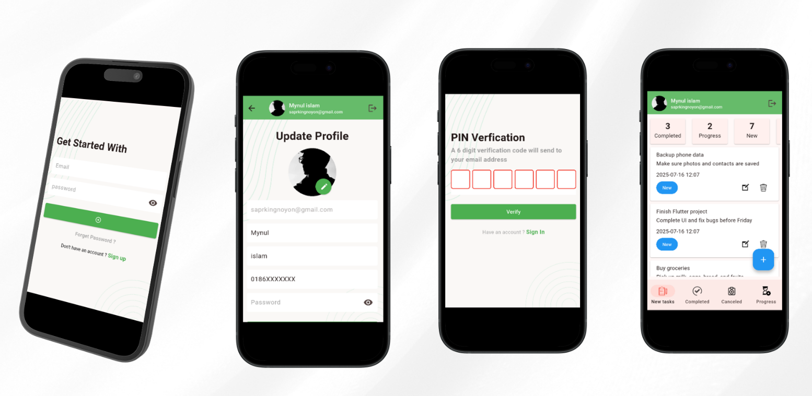

# task_manager1

A Flutter-based **Task Management** application built with **GetX** for state management, featuring **JWT-based authentication** for secure login sessions.  
Easily manage tasks with authentication, password reset, and profile management features.

---
## ✨ Features

- 🔑 **User Authentication** (JWT-based Login & Signup)
- 🔒 **Secure Token Storage** for session management
- 📧 **Forgot Password & Reset Password** functionality
- 👤 **Profile Management** (view & update profile with image upload in Base64)
- 📝 **Task Management** (create, update, delete tasks)
- 📊 **Task Status Tracking** (new, in-progress, completed, cancelled)
- 📱 **Responsive UI** with clean and modern design
- ⚡ **GetX State Management** for smooth and reactive experience

---
## 🛠️ Tech Stack

- **Flutter** (Frontend)
- **GetX** (State Management)
- **Dart** (Language)
- **JWT** (Authentication)
- **REST API** (Backend integration)

---

